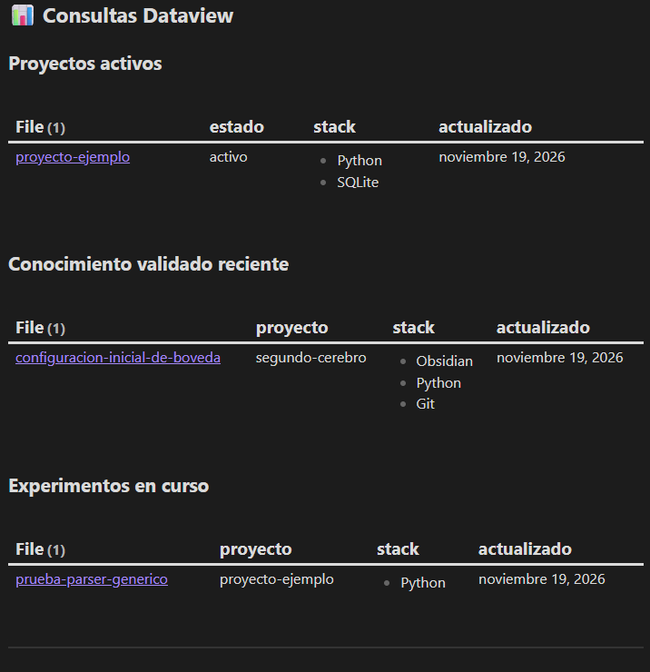

# 🧠 Segundo Cerebro — Template Repository

[](https://obsidian.md/)
[](#arquitectura)
[](AGENTS.md)
[](99_Sistema/Scripts/crear_nota.py)
[](https://github.com/new)
[](LICENSE)

Bóveda de **Obsidian** lista para clonar, pensada para estudios, desarrollo y automatización, e ideas creativas. Está diseñada para ser leída y actualizada tanto por personas como por agentes de código (OpenCode, Cursor, Windsurf, Antigravity…).

> [!NOTE] Qué incluye
> Estructura PARA · 4 plantillas de madurez del conocimiento · scripts en Python y PowerShell · **Dataview instalado y habilitado** · una nota `probado` de referencia · reglas normativas para agentes. Sin notas privadas de proyectos.

---

## ¿Por qué usar esta plantilla?

Trabajar con agentes de código tiene un problema silencioso: **todo lo que escriben parece igual de fiable**. Esta plantilla lo resuelve con tres mecanismos concretos:

1. **El conocimiento no se mezcla con el ruido.** El eje de madurez `teoria` → `experimento` → `probado` obliga a declarar en el frontmatter si una idea es especulativa, si está en prueba o si funciona de verdad. Así el agente puede citar código `probado` como fuente de verdad y tratar un `experimento` como referencia no confirmada, sin arrastrar pruebas fallidas a producción.
2. **Reglas explícitas de lectura y escritura para el agente.** [`AGENTS.md`](AGENTS.md) define la jerarquía de verdad, exige buscar en `03_Recursos/` y `01_Proyectos/` antes de proponer código e **ignora por completo `04_Archivo/`** para que el material histórico no contamine el contexto del LLM. Cualquier agente que abra la bóveda obedece las mismas reglas, sin importar la herramienta.
3. **Cero fricción desde el primer minuto.** El CLI [`crear_nota.py`](99_Sistema/Scripts/crear_nota.py) usa solo Python estándar (sin `pip install`) y Dataview viene preinstalado, así que el estado de la bóveda —proyectos activos, conocimiento validado y experimentos— se ve al instante como tablas en [`00_Dashboard.md`](00_Dashboard.md).

---

## Vista Previa



> [!TIP] Personaliza esta imagen
> Guarda tu propia captura en `docs/dashboard-preview.png` y sustituirá automáticamente esta vista previa.

---

## Arquitectura

### PARA + madurez del conocimiento

La estructura PARA decide **dónde vive** cada nota; el frontmatter decide **qué tan madura** está.

| Carpeta | Función | Índice |
| --- | --- | --- |
| `00_Inbox/` | Capturas, experimentos en curso y diarias | `_Inbox.md` |
| `01_Proyectos/` | Trabajo con meta, stack y repo | `_Proyectos.md` |
| `02_Areas/` | Responsabilidades continuas (Estudios, Dev-Stack, Automatizacion-IA) | `_Areas.md` |
| `03_Recursos/` | Teoría, conocimiento validado y mapas | `_Recursos.md` |
| `04_Archivo/` | Histórico. **Ignorar por defecto** | `_Archivo.md` |
| `99_Sistema/` | Plantillas, scripts, guías y convenciones | `Inicio.md` |

El template incluye datos de ejemplo neutros: `proyecto-ejemplo/` contiene [`proyecto-ejemplo.md`](01_Proyectos/proyecto-ejemplo/proyecto-ejemplo.md) y `00_Inbox/` incluye el experimento de muestra [`prueba-parser-generico.md`](00_Inbox/prueba-parser-generico.md). Así, [`00_Dashboard.md`](00_Dashboard.md) muestra tablas pobladas al clonar.

### Eje de madurez

```
teoria  →  experimento  →  probado
borrador   activo          validado
```

| `tipo` | `estado` | Plantilla | Destino |
| --- | --- | --- | --- |
| `teoria` | `borrador` | `tpl_teoria.md` | `03_Recursos/` |
| `experimento` | `activo` | `tpl_experimento.md` | `00_Inbox/` |
| `probado` | `validado` | `tpl_probado.md` | `03_Recursos/` |
| `proyecto` | `activo` | `tpl_proyecto.md` | `01_Proyectos/<slug>/<slug>.md` |
| `diaria` | `borrador` | (generada por [`crear_nota.py`](99_Sistema/Scripts/crear_nota.py)) | `00_Inbox/YYYY-MM-DD.md` |

**Promoción:** cuando un `experimento` se valida, se mueve a `03_Recursos/` (o a `01_Proyectos/<slug>/` si pasa a ser un proyecto) y su frontmatter cambia a `tipo: probado` + `estado: validado`, completando `## Condiciones y Entorno`. Nunca queda un experimento validado en el Inbox.

Las reglas completas para agentes están en [AGENTS.md](AGENTS.md); el índice navegable, en [00_Dashboard.md](00_Dashboard.md).

---

## Cómo usar este Template en otro PC

1. En GitHub, pulsa **Use this template → Create a new repository** (o clona este repo y elimina la carpeta `.git`).
2. Clona tu nuevo repositorio:
   ```powershell
   git clone https://github.com/TU-USUARIO/TU-REPO.git
   cd TU-REPO
   ```
3. Abre Obsidian y elige **Open folder as vault**, seleccionando la carpeta clonada.
4. Ve a **Ajustes → Community plugins** y desactiva **Restricted mode**.
   Después pulsa **Recargar** (`Ctrl + R`) o reinicia Obsidian.
5. Ya está: los bloques `dataview` de [00_Dashboard.md](00_Dashboard.md) se renderizan como tablas. Dataview se instaló vía archivos en `.obsidian/plugins/dataview/` y está habilitado en `.obsidian/community-plugins.json`.

> [!WARNING] Modo restringido
> El interruptor de *Restricted mode* se guarda en la configuración global de Obsidian, **no dentro de la bóveda**. Por eso no viene desactivado en el repo y hay que cambiarlo una vez por equipo.

**Requisitos:** Obsidian de escritorio · Python 3 (solo biblioteca estándar) para los scripts multiplataforma · PowerShell 5.1+ solo si usas la alternativa `.ps1` en Windows.

---

## Scripts

### [`crear_nota.py`](99_Sistema/Scripts/crear_nota.py) — crear notas (multiplataforma)

Sin dependencias externas. Resuelve las rutas por sí mismo, así que funciona desde cualquier directorio. Es la opción recomendada en cualquier sistema; `nueva-nota.ps1` queda como alternativa en Windows.

```powershell
python 99_Sistema/Scripts/crear_nota.py --tipo teoria --titulo "Grafos dirigidos"
python 99_Sistema/Scripts/crear_nota.py --tipo probado --titulo "Sesion HTTP reutilizable"
python 99_Sistema/Scripts/crear_nota.py --tipo experimento --titulo "Cliente API REST"
python 99_Sistema/Scripts/crear_nota.py --tipo proyecto --titulo "Sintetizador modular"
python 99_Sistema/Scripts/crear_nota.py --tipo diaria --titulo "Cierre de sprint"
```

- Sustituye `{{title}}` y `{{date:YYYY-MM-DD}}` por el título y la fecha reales.
- Genera nombres de archivo en `kebab-case` sin acentos. En `proyecto` el slug es también la carpeta: `01_Proyectos/<slug>/<slug>.md`.
- **No sobrescribe**: si el archivo existe, lo indica y termina.
- Refresca los índices automáticamente al terminar; usa `--no-indices` para omitirlo.
- La `diaria` lleva las secciones `## Log Técnico del Día`, `## Tareas / Bloqueos` y `## Ideas Rápidas`.

### [`actualizar_indices.py`](99_Sistema/Scripts/actualizar_indices.py) — regenerar índices (multiplataforma)

Reescribe únicamente el contenido entre los marcadores `<!-- INDICE:clave -->` a partir del frontmatter. Es idempotente y escribe UTF-8 sin BOM. Nunca escribas a mano dentro de esos bloques.

```powershell
python 99_Sistema/Scripts/actualizar_indices.py
```

En Windows, `.\99_Sistema\Scripts\actualizar-indices.ps1` hace lo mismo.

### Otros scripts

| Script | Función |
| --- | --- |
| [`actualizar_indices.py`](99_Sistema/Scripts/actualizar_indices.py) | Regenera los bloques `<!-- INDICE:... -->` desde el frontmatter (multiplataforma) |
| [`nueva-nota.ps1`](99_Sistema/Scripts/nueva-nota.ps1) | Alternativa en Windows: acepta `-Proyecto` y `-Stack`, refresca índices y puede abrir la nota con `-Abrir` |
| [`actualizar-indices.ps1`](99_Sistema/Scripts/actualizar-indices.ps1) | Alternativa en Windows del indexador |
| [`diaria.ps1`](99_Sistema/Scripts/diaria.ps1) | Crea y abre la diaria de hoy |
| [`instalar-tarea.ps1`](99_Sistema/Scripts/instalar-tarea.ps1) | Programa la diaria automática a las 08:00 (tarea de Windows) |

La guía operativa completa está en [Guía del sistema](<99_Sistema/Guía del sistema.md>) y las convenciones de metadatos en [Convenciones](99_Sistema/Convenciones.md).

---

## Archivos ignorados

`.gitignore` excluye el estado de sesión de Obsidian (`workspace.json`, `workspace-mobile.json`, `cache/`), `__pycache__/`, `.DS_Store` y `Thumbs.db`. **No** excluye `.obsidian/community-plugins.json` ni `.obsidian/plugins/dataview/`: la configuración del plugin se versiona a propósito para que el template llegue funcionando.

---

## Verificación de referencia

La nota [`configuracion-inicial-de-boveda`](03_Recursos/configuracion-inicial-de-boveda.md) es conocimiento `probado / validado`: documenta la estructura, la configuración de `.obsidian/`, los scripts y el entorno verificado. Es la fuente de verdad absoluta según [AGENTS.md](AGENTS.md).
